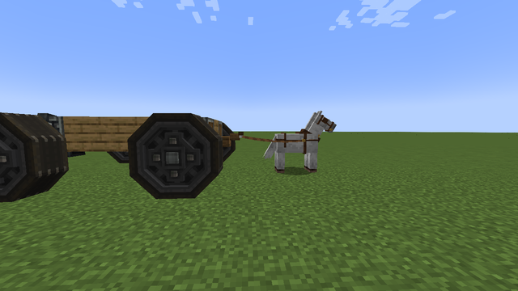

# Harness: animals pulling Create: Aeronautics vehicles

Read before touching `harness/`. Proof of concept agreed with Aaron 2026-11-24: horses first, other animals are
calibrated later from the same data.

## How it fits
- Separate mod `ringbearer_harness` (package `com.porcupinestudios.ringbearer.harness`). It requires Create,
  Create: Aeronautics 1.3.2+ (with Simulated and Offroad inside) and Sable 2.0.6+, and depends on neither `lotr` nor
  `tardis`: which animals pull is data, by entity type id (`lotr_port:horse` is just a name in a file).
- The vehicle is an ordinary Aeronautics contraption: blocks assembled into a Sable sub-level (Simulated's assembler in
  game, `SubLevelAssemblyHelper.assembleBlocks` in tests), rolling on Offroad wheel mounts with tires. The hitch is
  one more block on it.
- `HitchBlockEntity` is a Sable `BlockEntitySubLevelActor`, like Offroad's `WheelMountBlockEntity`: Sable calls
  `sable$physicsTick` every physics substep (2 a tick by default) and `sable$tick` every tick. The pull goes in through
  a `ForceTotal` (local frame, impulse at the hitch point) and `RigidBodyHandle.applyForcesAndReset`, as the wheels do.
- Animals stay ordinary entities on their own legs (their AI, a rider, or a test script moves them). A hitched animal
  carries attachment `hitch_link` (the hitch block's position in the plot; saved and synced to clients); after its
  tick, `restrain` holds it back if it got further than its rest length + `slack` from the hitch.
- **Harness (item, worn)**: use it on a tamed, grown animal with draught data; it goes on in place of a saddle (a
  saddled horse's saddle comes back to you). Attachment `harness_worn` (saved, synced). A harnessed horse can't be
  saddled (`AbstractHorseSaddleMixin` makes `isSaddleable` false, which shuts both the saddle item and the inventory's
  saddle slot); using a saddle on it says so. Shears take it off (unhitching first); it drops when the animal dies.
  `content/Harnessing`, `HarnessItem`.
- **Hitch (block)**: the block on the vehicle (called "harness" in the first build; registry aliases keep those).
  Lead harnessed animals to it and use it: it hitches every harnessed animal you lead within 10 blocks and takes their
  leads (an unharnessed one stays on its lead, with a message). Sneak-use with an empty hand unhitches them back onto
  your leads, harnesses on.
- **Two ropes**: from the hooks at the ends of the hitch's bar (`models/block/hitch.json`, `RopeRenderer` HOOK_*) to the
  harness's tug rings on the animal's sides (`assets/<ns>/harness_fit/*.json`: `rope_anchor` [side, up, forward],
  `rope_color`), drawn like leads after the animal (`RenderLivingEvent.Post`) through the vehicle's interpolated render
  pose (`ClientSubLevel.renderPose(partialTick)`). The physics still pulls at one point between them (two parallel
  traces pull the same as one at their middle).
- **Looks**: `client/HarnessModel` is the vanilla horse's part tree (same pivots, so it follows body, neck and head)
  holding only harness boxes: padded collar with brass hames, bridle (noseband, crownpiece, cheek straps, bit rings,
  blinkers), backpad, girth, hip strap, breeching, side straps and brass tug rings. `HarnessLayer` draws it like horse
  armour on every horse-family renderer (horse, donkey, mule, skeleton and zombie horse). Textures from
  `harness/tools/textures.py`. LOTR's own horse renderers aren't covered (lotr can't be referenced): they get the
  ropes but no harness drawn.

## The pull (`physics/`, pure maths, JUnit `CouplingTest`)
1. **Where the traces start** (`tow_point`, turned with the animal's body). Sable steps physics at the start of the
   level tick, before entities move, so substep k of n uses the animal's last two positions interpolated at (k+1)/n.
2. **`AnchorTracker`**: a critically damped follower of that point with the point's own velocity fed forward
   (backward Euler, stable at any step). Feed-forward: no lag at a steady pace (a plain smoother lags speed x time
   constant, which pulled the wagon onto the horse at a canter). It rounds off tick-boundary velocity jumps and
   step-ups. `smoothing_hz`.
3. **The pole hinge**: only the level (world horizontal) gap from hitch to tow point counts, and the pull is level.
   Vertical moves of the animal (steps, jumps, bobbing) and the vehicle pitching over a bump don't change it. Measured
   in the vehicle's own tilted floor instead, every 1-block step-up on a 14-degree slope read as a quarter block of
   stretch and kicked the wagon at the pull limit (2026-11-24).
4. **`TraceCoupling`**: one implicit spring-damper along the traces, set by `stiffness_hz` and `damping_ratio` against
   Sable's effective mass at the hitch along the traces (`MassData.getInverseNormalMass`). Same response for a cart or
   a loaded wagon, unconditionally stable (an explicit stiff spring at 2 substeps a tick is what turns into vibration).
5. **Limits**: at most `max_pull` forward; at most `max_push` back (braking), scaled by how squarely the animal stands
   ahead of the hitch (one beside the wagon can't brake it through its traces).

## Steering, the pole and the animal's side
- **Front axle**: `HarnessSteering` + mixin `WheelMountSteeringMixin` (wraps the two redstone reads in Offroad's
  `WheelMountBlockEntity.getSteeringSignal`): wheel mounts ahead of the vehicle's centre of mass steer toward the
  traces (`steer` x trace angle; Offroad's own limit is 30 degrees = signal 15, 2 degrees a step). Offroad then turns
  the wheels in its physics and syncs them to clients, so they visibly turn. Without it four fixed wheels refused to
  turn and the traces ended up at 100-110 degrees to the wagon.
- **Pole angle**: the animal can't swing round further than `max_angle` (60) from straight ahead of the hitch; in a
  turn tighter than the wagon can follow (30-degree wheels on a 4-block wheelbase: ~7-block radius) it walks a wider
  circle instead of jackknifing.
- **Straining** (`Straining`): a movement-speed modifier from the animal's strain (its pull averaged over each tick
  against `max_pull`, or stretch against `slack`, smoothed over ~1 s): free up to 0.4, then down in a straight line to
  `1 - load_slowing` at full strain. Attributes sync to the client, so a ridden horse slows on the rider's side too. A
  faster or steeper curve made its own 3 Hz pull/push shudder on an overloaded climb.
- **Hold-back** (`restrain`, after the animal's tick): the last resort. Past `rest + slack`, closer than
  `rest - push_slack`, or round past `max_angle`, the animal is moved back by half the overshoot a tick, that correction
  changing by at most 0.02 blocks/tick a tick (a shove builds up over a few ticks; a one-tick snap read as a yank),
  all at once past half a block.

## Data: `data/<ns>/draught/<name>.json` (reload listener, /reload)
`entities`, `tow_point` [right, up, forward], `min_gap`/`max_gap` (rest length = level distance at hitching, clamped),
`max_pull`, `max_push`, `stiffness_hz`, `damping_ratio`, `smoothing_hz`, `slack`, `push_slack`, `break_distance`,
`steer`, `max_angle`, `load_slowing`. Forces are Sable units (its block masses x blocks/s^2): the 3x5 plank test wagon
has mass 14.5 and weighs 160; with 27 iron blocks, 122.5 and 1348. Horse (`horse.json`, minecraft and lotr_port
horses): 1.2 Hz, damping 0.5, pull 400, push 200; chosen from the calibration grid below. Other animals: copy and
calibrate (pull for their size, stiffness for how tight their traces should feel).

## Tests and metrics
GameTests `HarnessTests` (`./gradlew :harness:runGameTestServer`; the run task deletes `run/world` first, see
Gotchas). `TowRun` lays a 48x72 course near the world origin (flat; 1-in-4 block staircase slopes uphill, downhill
and to the side; an uphill road of slab half-steps), builds a 3x5 plank wagon on four Offroad wheel mounts with tires
plus the harness, assembles it, hitches a horse and drives the horse from its own entity tick like a rider (speed and
heading each tick, scaled by its speed attribute): settle 1.5 s, speed up 2 s, cruise 2 s, turn (or cruise), slow
down 1.5 s, stand 3 s. Every physics step is recorded; `TowMetrics` measures it and writes
`harness/run/harness-metrics/summary.txt` plus a CSV per run (positions included).
`-Dringbearer_harness.sweeps=true` adds the calibration grid (stiffness 0.8/1.0/1.2 Hz x damping 0.5/0.7/1.0 on
uphill, canter, tight turn, downhill; report only). `-Dringbearer_harness.metricsOnly=true` reports without failing.

| Metric | Means | Too high = |
|---|---|---|
| stretch max / rms | traces longer or shorter than rest (blocks) | too soft and stretchy |
| vibration | force left after a centred 0.3 s average, over its rms | rough pull |
| shake | how often that fast part swings side to side (Hz) | vibration (a bump answered is 1-2 Hz) |
| chatter | pull/push flips per second | rattling |
| wobble rms/peak | fast pitch+roll rate (deg/s, 0.3 s high-pass) | shaking, bumps |
| yaw-shake | fast yaw rate | fishtailing |
| accel peak (horse) | wagon's peak acceleration per tick, and the horse's own | kicks / horse yanked |
| jerk rms | change of acceleration per tick | jerky |
| stop settle / rings | time to settle and swings (>0.05 block) after the horse stops | springy |
| trace angle max | traces against the wagon's forward | jackknifing |
| cost | microseconds of harness code per substep | performance |

Results 2026-11-24 (local GameTest server; 13 required runs passed 3 runs in a row; at 4 blocks/s unless noted):

| Run | Stretch | Vibration | Shake | Wagon accel (horse) | Wobble rms | Stop | Trace angle | Cost us |
|---|---|---|---|---|---|---|---|---|
| flat straight | 0.12 | 0.022 | 0 | 4.3 (4.0) | 0.0 | 0 s | 0 | 1.2 |
| flat canter 8 b/s | 0.25 | 0.025 | 0 | 8.7 (8.0) | 0.0 | 0.05 s | 0 | 1.0 |
| flat gentle turn 20 deg/s | 0.13 | 0.022 | 0 | 4.0 (4.0) | 0.0 | 0 s | 19 | 1.0 |
| flat tight turn 45 deg/s | 0.23 | 0.018 | 0 | 3.1 (3.6) | 0.0 | 0.30 s | 65 (pole) | 0.9 |
| side slope straight (roll 14.5) | 0.12 | 0.022 | 0 | 4.3 (4.0) | 0.1 | 0 s | 4 | 1.0 |
| side slope tight turn | 0.24 | 0.038 | 0 | 6.3 (4.7) | 8.5 | 0.28 s | 65 | 1.1 |
| uphill straight (block steps) | 0.16 | 0.31 | 2.1 | 16.8 (4.0) | 13.5 | 0 s | 0 | 1.0 |
| uphill slab road | 0.17 | 0.31 | 2.0 | 9.6 (4.0) | 13.2 | 0 s | 0 | 1.4 |
| downhill straight | 0.17 | 0.22 | 1.4 | 11.1 (4.0) | 6.9 | 0 s | 1 | 0.9 |
| overloaded uphill (27 iron) | 0.53 | 0.43 | 1.6 | 8.7 (4.3) | 20.6 | 0.98 s | 1 | 0.9 |

Findings:
- Flat ground and side slopes are smooth: the wagon's acceleration matches the horse's, no vibration, stops settle
  without swinging.
- On 1-block staircase slopes the kicks (~16 blocks/s^2) and pitch wobble come from Offroad's wheels climbing each
  step, not the traces: the same from 0.3 to 2.4 Hz (sweeps). Softer, less damped traces pass less of it on (that is
  why damping 0.5). A slab road nearly halves the kicks and pitch (25 -> 16 degrees).
- Stiffer than ~1.5 Hz: more vibration and chatter everywhere; softer than ~1 Hz: the canter stretches half a block.

## Gotchas
- **Far from the origin Sable's positions round off**: at the GameTest server's test positions (~7 million blocks
  out) a wagon could only move in quarter/half-block steps and froze. Tests lay their courses near the origin.
  Vehicles that far out in a real world would suffer the same.
- **Sable saves vehicles with the world**: the GameTest server reuses `run/world`, and wagons from an earlier (crashed)
  run reloaded on the new courses and jammed the new ones (looked like random frozen wagons). The run task deletes it.
- `GameTestHelper.runAtTickTime` from inside a scheduled callback crashes (the timer map is iterated); schedule up
  front.

## Screenshots (dev showcase)
`-Dringbearer_harness.showcase=true`: when a player joins, `dev/Showcase` builds the test wagon (`dev/TestWagon`, the
same as the GameTests') with a harnessed horse hitched, and a second harnessed horse, on the ground under them;
`client/ShowcaseCamera` puts the player in spectator, flies to five viewpoints, saves `screenshots/harness_*.png` and
quits. Headless, from a save made from the GameTest server's flat world (2026-11-24):
```
cp -r harness/run/world harness/run/saves/showcase   # then allowCommands 1 in level.dat (nbtlib), options.txt
JAVA_TOOL_OPTIONS=-Dringbearer_harness.showcase=true LIBGL_ALWAYS_SOFTWARE=1 xvfb-run -a \
  -s "-screen 0 1280x800x24 +extension GLX" ./gradlew :harness:runClient -PquickPlay=showcase -PwindowSize=1280x720
```
 
 

## Movies of the tow runs (dev)
`-Dringbearer_harness.movies=true` (or `=run,run`): when a player joins, `dev/Movies` plays the GameTest runs
(`HarnessTests.SCENARIOS`) one by one on courses beside them (`TowRun.Host`; ground in smooth stone, which compresses
far better than grass), with the server's tick rate at 5 (`ringbearer_harness.movieTickRate`; physics steps per tick,
so it's unchanged). `client/MovieRecorder` follows each rig from the side through a critically damped (~1 s) camera,
so the camera can't add or hide jitter, and saves every rendered frame with its game time (`run/movie/<run>/`, ~140
frames per game second at 854x480 under software GL). `harness/tools/movies.py [fps] [width]` picks the frames nearest
to even game-time steps and writes `run/movies/<run>.gif` (default 40 fps, 480 wide, ~16-24 MB each) and a 60 fps
MP4 (~4-7 MB). Same save and command as the screenshots, with `-PquickPlay=<save> -PwindowSize=854x480`
(2026-11-24: all 13 runs, about 15 minutes; 7 slope/wheel/sled runs in 8 minutes).

Found while making them: in singleplayer the test driver also ran for the client's copy of the horse (same entity
id, and `Entity.equals` compares ids), moving the horse twice a tick; the driver now runs server side only.

## Slopes (`content/SlopeBlock`, `SlopeContacts`, `physics/Convex`, `Sat`)
Right-triangle blocks placed like stairs: the low edge faces the player, and clicking the top half of a face (or the
underside of a block) places one upside down. `oak_slope`/`stone_slope` rise 1 block over 1 (45 degrees); the gentle
pairs `*_slope_low` (0 to 0.5) and `*_slope_high` (0.5 to 1) make a 2-block ramp at 27 degrees. Models are OBJ files made
by `tools/slopes.py` (with blockstates, item models, loot tables and recipes).
- Entities (and the vanilla collision shape) see 4 stair slices per block: vanilla step-up tries the first height that
  helps, so 16 fine slices slowed walking animals.
- Sable gets no collider from slopes (`BlockSubLevelCollisionShape` returns empty; its colliders come only from
  boxes). Instead `SlopeContacts`, before each physics substep, tests each vehicle's slope wedges against the world's
  blocks, and the world's slope wedges against each vehicle's blocks, with a separating-axis test. A push only goes
  along a face normal that isn't blocked by the neighbouring geometry (so a wedge never catches on the internal edge
  where it meets a block), and all contacts of a vehicle share one sequential-impulse accumulator (several corners
  touching at once don't add up into a launch). The push is the same soft spring-damper as the traces, with friction;
  stiffness, damping and friction are per block in `data/<ns>/slope_contact/*.json` (now 3 Hz, critical, 0.1).
- On a vehicle, upside-down slopes in front of a sled's deck are a nose that rides it up over a block edge.

## Wagon wheels (`content/WagonWheelBlock`, `WagonWheelBlockEntity`, `WheelTerrain`)
A spoked wheel block (radius 0.9, model `client/WagonWheelModel`) whose axle points out of the vehicle. Each physics
substep it finds the ground under it by sweeping an ellipse (reach 3, height 1.5) over the true block tops (slopes
analytically) along three lines across the tyre, so a 1-block step is met as a gentle ramp instead of a 45-degree wall;
then a soft spring along the vehicle's up through the contact point, grip across the tyre, rolling drag (capped by the
load) and steering from the hitch (`HarnessSteering.degreesFor`, front wheels only). The client draws the hub at the
suspension height, rolling with distance and turned with the steering. All numbers are in `data/<ns>/wheel/*.json`.

Results (horse at a trot, wagon 12.5, same course; `harness-metrics/`):

| run | accel peak | jerk rms | wobble rms | vibration |
|---|---|---|---|---|
| Offroad wheels, 1-block steps (`uphill_straight`) | 16.8 | 62 | 13.8 | 0.31 |
| Offroad wheels, steps with 45-degree slopes | 10.9 | 51 | 12.0 | 0.27 |
| wagon wheels, 1-block steps (`wagon_uphill`) | 4.7 | 9.5 | 1.9 | 0.08 |
| wagon wheels, 45-degree slopes | 4.8 | 10.7 | 2.5 | 0.09 |
| wagon wheels, gentle slopes | 4.5 | 8.2 | 2.2 | 0.07 |
| sled on flat | 4.4 | 5.0 | 0 | 0.03 |
| sled up one block on a 45-degree ground slope (`sled_ramp`) | 23 | 95 | 5.2 | 0.19 |
| sled up one bare block on a gentle nose (`sled_gentle_step`, report-only) | 57 | 180 | 5.4 | 0.27 |

Sleds: a 45-degree nose can't get a 15-block sled up a bare block with one horse (`sled_step`); the gentle 2-block
nose can, but only at the limit of the horse's pull (the traces reach their slack plus a bit in some runs), so those
runs are report-only (`HarnessTests.HARD`), with `overloaded_uphill` (whether its heavy stop swings once or 3 times
varies by run). Sleds over repeated steps are rough. The cost mark leaves out the single worst step (a 48 ms GC or
class-load pause once decided a run's mean).

## Status
- 2026-11-24: proof of concept, horses calibrated; numbers above.
- 2026-11-24: wearable harness, hitch block, two ropes; GameTests `WearingTests` (harness replaces the saddle and
  keeps saddles off, only tame grown horses, hitching needs a harness, shears take it off and unhitch, drops on
  death); looks checked in a headless client (screenshots above).
- 2026-11-24: slopes (45-degree and gentle pairs, placed like stairs) with their own contact solver, wagon wheels,
  sleds; 37 required GameTests passed twice in a row in the sandbox, movies checked (above).
- Not yet: teams in formation (several animals on one hitch all pull at the same
  point), ridden horses tried in a client (the slowing syncs; the hold-back is server-side and may rubber-band a rider
  who pushes past it), sleigh runners (anisotropic friction), other animals, the howdah (carry mode).
